# Application Screenshots

Screenshots showcasing key screens of the **Hospital Appointment Scheduling System (Patient Booking Module)**:

| # | Screen | Description | Preview |
|---|---|---|---|
| 1 | **Registration** | Patient registration form with validation | 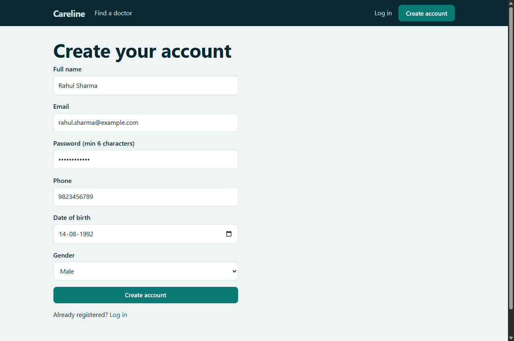 |
| 2 | **Login** | Secure JWT authentication with demo credentials pre-annotated | 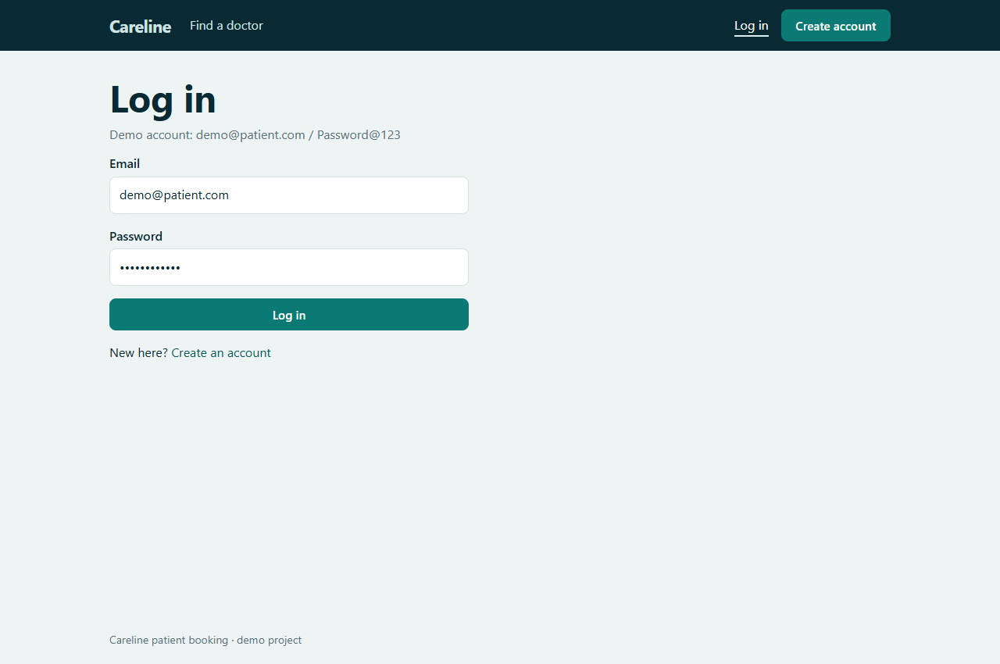 |
| 3 | **Find Doctors** | Doctor directory search with dynamic specialization chips | 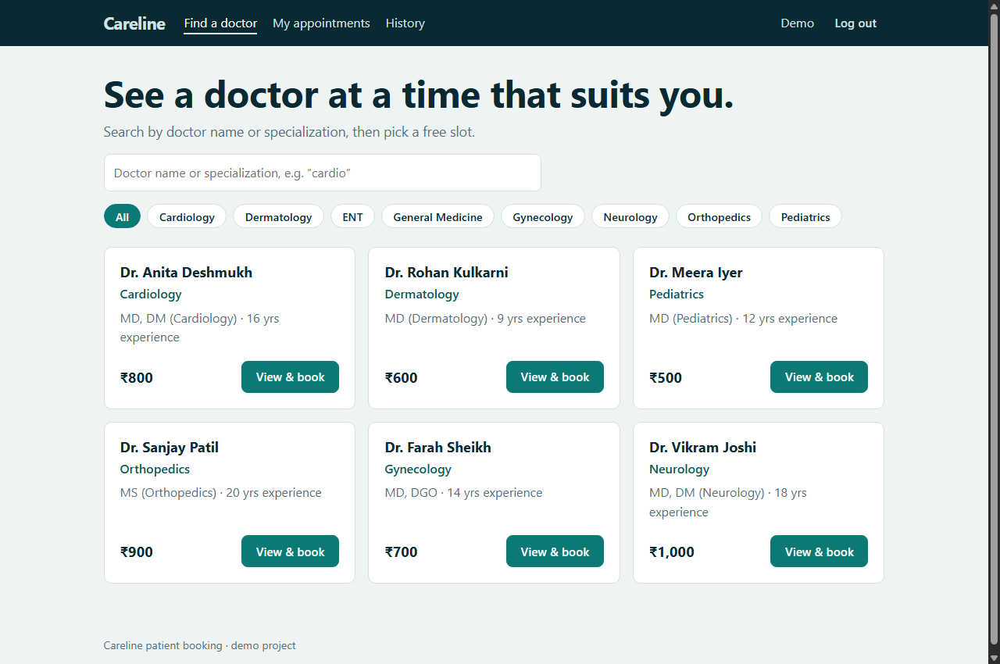 |
| 4 | **Doctor Details & Slots** | Doctor profile, qualification, fee, date picker and available time slots | 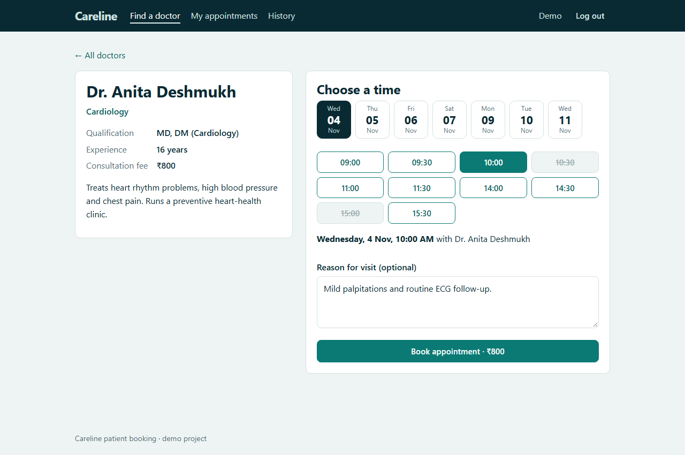 |
| 5 | **Booking Confirmation** | Booking confirmation banner with reference code and instant appointment summary | 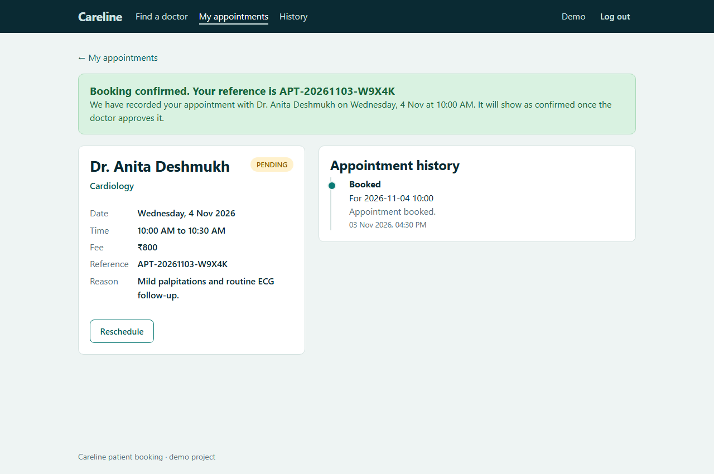 |
| 6 | **Upcoming Appointments** | Upcoming appointments with status badges, doctor details and action buttons | 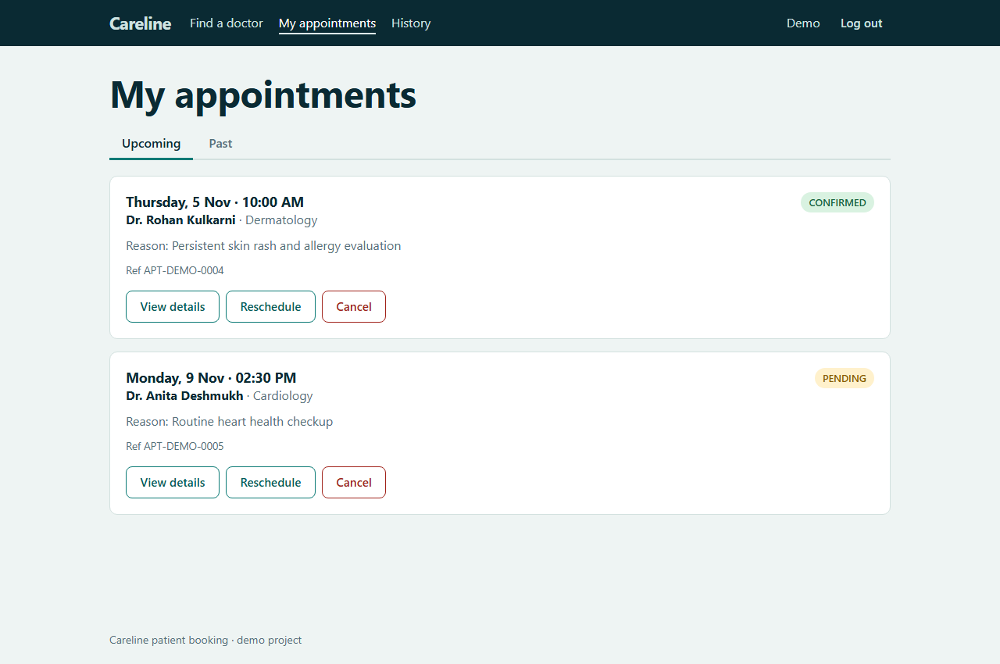 |
| 7 | **Past Appointments & Rejections** | Past tab displaying completed, cancelled, and doctor-rejected appointments with callout reasons | 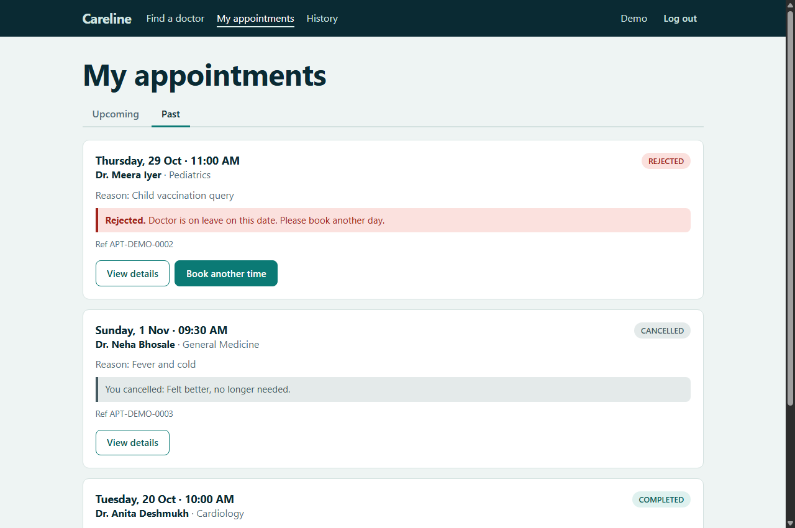 |
| 8 | **Reschedule Appointment** | Rescheduling flow allowing the patient to pick a new date/time slot with the same doctor | 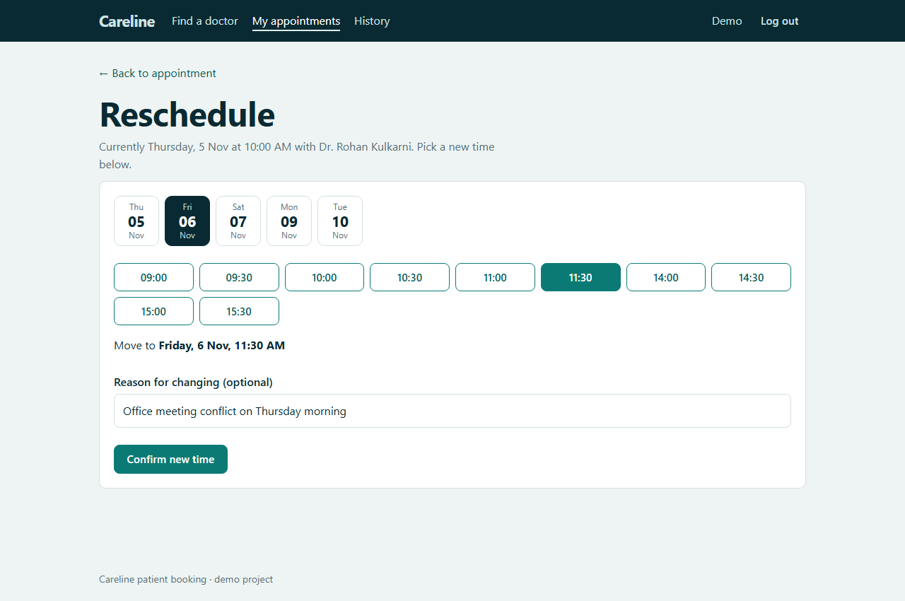 |
| 9 | **Cancel Appointment** | Cancellation prompt with optional reason field | 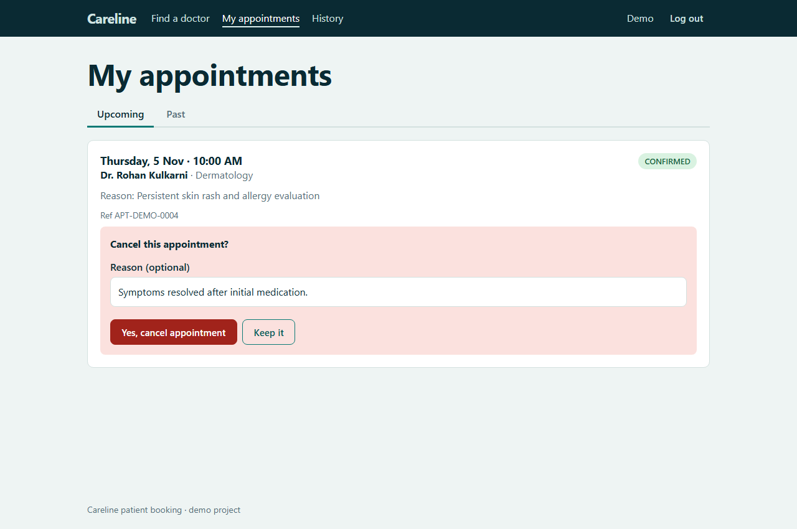 |
| 10 | **Appointment History** | Complete audit timeline of all booking, rescheduling, and cancellation events | 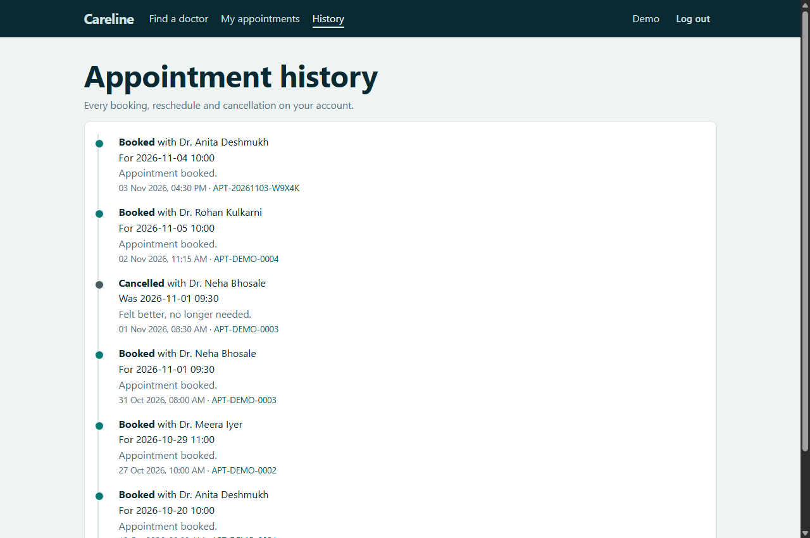 |
| 11 | **Patient Profile** | Profile management screen to view and update demographic information | 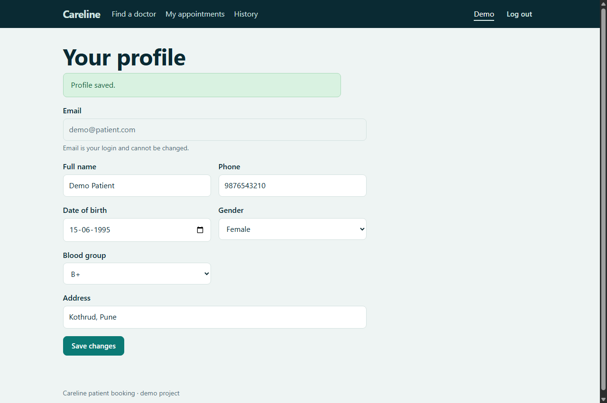 |
